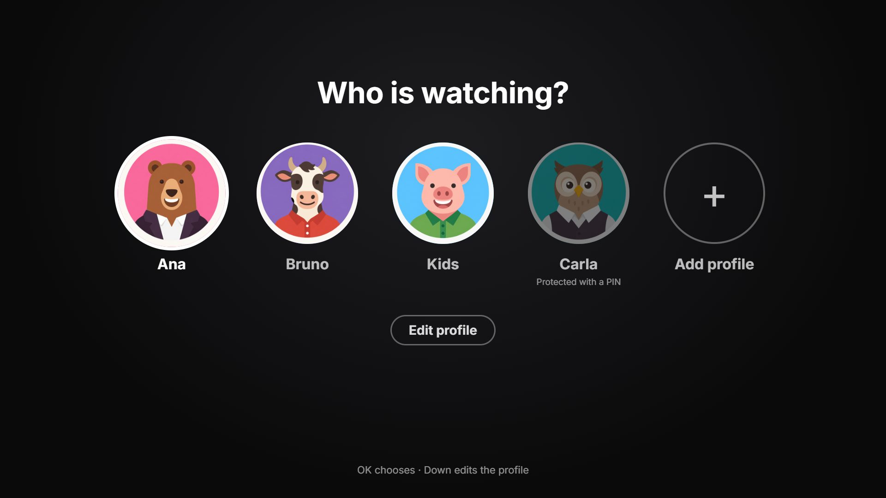
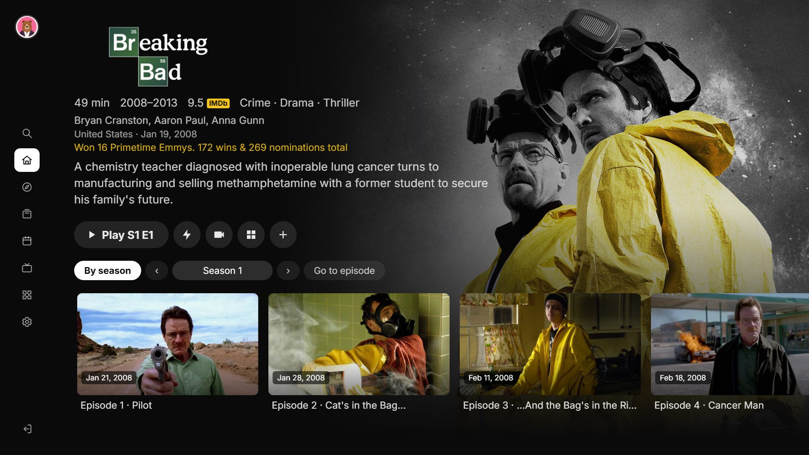
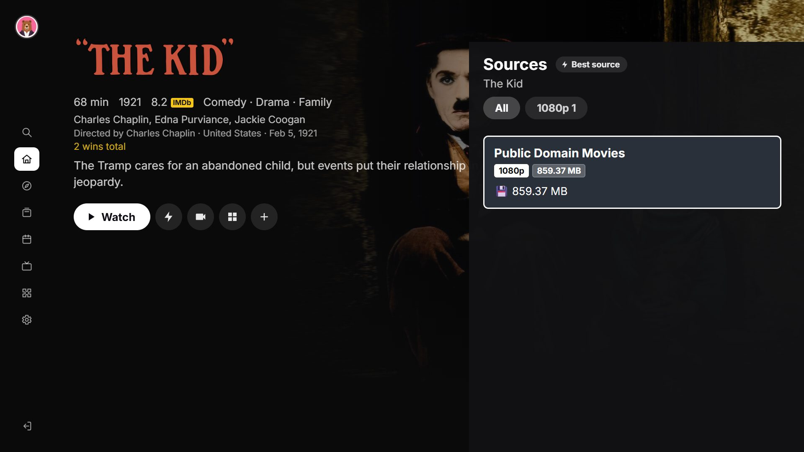

# StremCompat para TVs Samsung (Tizen)

  

  
  
  
  
  

<a href="README.md">English</a> · <b>Português</b>

O StremCompat leva sua conta e seus addons do **Stremio ou do Nuvio** para TVs Samsung com Tizen 4 ou mais novo, com uma interface feita para o controle remoto. É um projeto independente e não oficial, sem ligação com o Stremio, o Nuvio ou a Samsung, e toca apenas o que os seus addons oferecem.

> **Versões de teste.** O suporte à Samsung é mais novo que o da LG e foi testado em poucas TVs, então podem aparecer problemas. Conte como foi no seu modelo em [Discussions](https://github.com/StremCompat/samsung/discussions).

## Duas versões

| | **StremCompat** | **StremCompat Native** |
|---|---|---|
| Situação | **Recomendada** | **Beta**, ainda não estável: mais rápida, mas pode ter falhas |
| Como é feita | A interface como página | O app nativo (C, SDL2, OpenGL ES) compilado para o navegador da TV (WebAssembly, com uma versão em JavaScript para o Tizen 4) |
| ID do app | `StrmCompat.App` | `StrmCmpNtv.App` |

As duas podem ser instaladas juntas. Na primeira vez que abre, a versão Native traz sua conta, biblioteca e ajustes da versão web.

## Recursos

O mesmo app da LG ([lista completa](https://github.com/StremCompat/webos/blob/main/README.pt.md#recursos)):

- Conta Stremio ou Nuvio com QR ou e-mail, perfis do Nuvio com PIN e Coleções do Nuvio como nos apps do Nuvio.
- Início, Descobrir, Busca, Biblioteca, Continuar assistindo, episódios novos e próximos e, para contas Stremio, um Calendário.
- Canais ao vivo de addons (como o NexoTV) e de listas M3U, com programação atual e busca.
- Loja de addons, adicionar addons e listas pelo endereço (digitado ou colado pelo celular) e organizar as fileiras do Início.
- Melhor fonte, filtros de fontes, legendas e áudio lembrados por série, pular abertura e próximo episódio, vídeo com o player da própria Samsung (AVPlay).
- Leve, pensado para TVs mais antigas.
- Onze idiomas.

**Diferenças em relação à LG:**
- **Torrents** precisam de um servidor de streaming em outro computador (Ajustes > Servidor de streaming > Endereço). Debrid e links diretos funcionam sem ele.
- **Não disponíveis:** prévias ao avançar, selos técnicos na tela de pausa e trailers de fundo, que dependem do FFmpeg.
- **Atualizações** vêm como um pacote novo em Releases; na Samsung o app não consegue se instalar sozinho.

## Capturas de tela

Capturadas da interface real em 1920x1080, com uma conta de demonstração, os addons oficiais do Stremio e uma lista pública de canais. A interface é a mesma na LG, na Samsung e no Android TV.

<table>
  <tr>
    <td width="50%" valign="top"> <b>Início</b> Seus catálogos em fileiras, com o título em foco em destaque no topo.</td>
    <td width="50%" valign="top"> <b>Quem está assistindo</b> Perfis do Nuvio, com os protegidos por PIN marcados.</td>
  </tr>
  <tr>
    <td width="50%" valign="top"> <b>Página da série</b> Detalhes, elenco, temporadas e episódios com datas de estreia.</td>
    <td width="50%" valign="top"> <b>Fontes</b> Todas as fontes que seus addons encontram; ou a Melhor fonte num botão.</td>
  </tr>
  <tr>
    <td width="50%" valign="top"> <b>Canais ao vivo</b> Categorias à esquerda, canais e programação atual à direita.</td>
    <td width="50%" valign="top"> <b>Loja de addons</b> Addons da comunidade por popularidade, com imagem e descrição.</td>
  </tr>
</table>

## Instalação

1. Baixe o `.wgt` da versão que você quer em [Releases](https://github.com/StremCompat/samsung/releases):
   - `StremCompat-v…-Samsung.wgt` (versão web);
   - `StremCompat-Native-v…-Samsung.wgt` (versão Native).
2. Ative o **Modo Desenvolvedor** na TV: abra Apps, digite `12345` no controle, ligue o Developer Mode e coloque o endereço IP do seu computador; depois reinicie a TV.
3. No computador, instale o **Tizen Studio** com as extensões de TV, abra o **Device Manager**, conecte à TV pelo IP e escolha **Install app** com o `.wgt`.
4. Em TVs com Tizen 7 ou mais novo (2023 em diante), o pacote precisa ser assinado de novo com o seu próprio certificado Samsung (Certificate Manager, no Tizen Studio) antes de instalar.

## Compatibilidade

| TVs Samsung | Tizen | Situação |
|---|---|---|
| 2018, série N | 4.0 | Testada em uma TV (UN75NU7100) |
| 2017, série M | 3.0 | Deve funcionar, ainda não testada |
| 2019 e 2020, séries R e T | 5.0 e 5.5 | Pode funcionar, não testada |
| 2021 e 2022 | 6.0 e 6.5 | Pode funcionar; essas TVs podem usar o app oficial do Stremio |
| 2023 ou mais novas | 7.0 ou mais novo | Precisa do seu próprio certificado (veja acima) |
| 2015 e 2016 | 2.x | Não suportadas |

## Problemas comuns

- **"O serviço do app não iniciou":** feche o app, tire a TV da tomada por 30 segundos e abra de novo.
- **Torrents não tocam:** coloque o endereço de um servidor de streaming nos Ajustes, ou use fontes debrid e diretas.
- **Uma fonte não toca:** tente primeiro uma fonte H.264/AAC moderada.

## Outras TVs e o projeto

O StremCompat fica na [organização StremCompat](https://github.com/StremCompat):

- **LG** (webOS 3 ou mais novo): [StremCompat/webos](https://github.com/StremCompat/webos)
- **Samsung** (Tizen 4 ou mais novo): [StremCompat/samsung](https://github.com/StremCompat/samsung) (esta página)
- **Android TV / Google TV** (7.0 ou mais novo): [StremCompat/android-tv](https://github.com/StremCompat/android-tv)
- Código-fonte: [StremCompat/stremcompat](https://github.com/StremCompat/stremcompat) (versão web e servidor local) e [StremCompat/native](https://github.com/StremCompat/native) (versão Native).

## Dúvidas e suporte

Dúvidas e resultados de compatibilidade em [Discussions](https://github.com/StremCompat/samsung/discussions), bugs que dá para reproduzir em [Issues](https://github.com/StremCompat/samsung/issues).

Se o StremCompat foi útil para você, você pode me [pagar um café ☕](https://buymeacoffee.com/Alexesmm), totalmente opcional. Uma estrela no GitHub também ajuda.

O StremCompat é licenciado sob a [GPL-3.0](LICENSE). Stremio, Nuvio e Samsung são marcas de seus donos.
